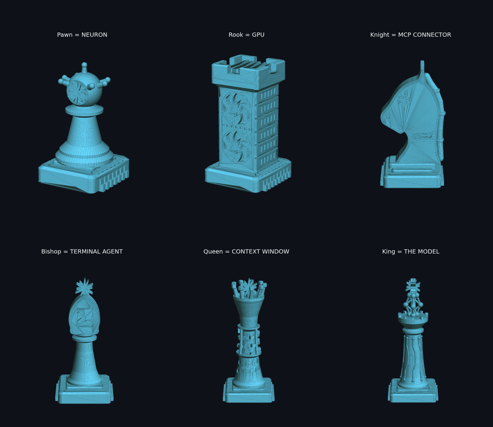
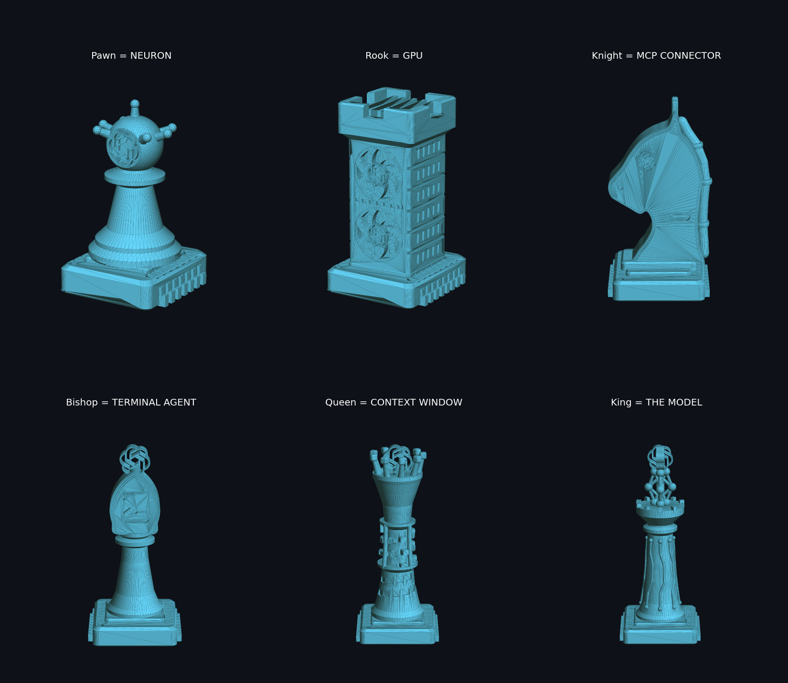

# chess-set-ai

A 3D-printable chess set themed on AI and technology. Every piece is a piece of the AI stack, and its rank on the board matches its importance in the stack. There is no text on any piece; the shape says what it is.

**White = Claude, black = GPT.** Both sides use the same designs. The only difference is the model emblem, which sits in a prominent spot on every piece.

| Claude (white) | GPT (black) |
|---|---|
|  |  |

## The pieces

| Piece | Is | Why |
|---|---|---|
| King | **The model**: a small neural network (input, hidden and output layers) on a PCB-traced body, with the emblem as the output node | Everything exists to protect it |
| Queen | **Context window**: a window sliding up a spiral ribbon of tokens. Tokens below the window are faded, tokens inside it are raised, and a cursor marks the next one | The most powerful piece: what the model can see at once |
| Bishop | **Terminal agent (Claude Code)**: a terminal window with a `>_` prompt and window buttons | Moves far in a straight line, like an agent working through a codebase |
| Knight | **MCP connector**: a horse head with plug-prong ears, a cable along its back and socket slots in the neck | Jumps between pieces the way MCP connects tools |
| Rook | **GPU**: a tower of cooling fins and fans | The heavy compute that holds the corners |
| Pawn | **Neuron**: a cell body with dendrites | Many small units that add up |

All pieces stand on a microchip base.

## Files

- `*_claude.stl` and `*_gpt.stl`: one file per piece. You need 1 king, 1 queen, 2 bishops, 2 knights, 2 rooks and 8 pawns per side.
- `plate_white_claude_16_pieces.stl` and `plate_black_gpt_16_pieces.stl`: a whole side (16 pieces) on one 4x4 plate.
- `preview.png` and `preview_gpt.png`: preview renders.

## Printing

- Scale: 100%. The king is about 85 mm tall and bases are 27 to 36 mm wide.
- Every piece is a single solid part, designed with 45° overhangs, so most pieces print without supports. The knight's ears and the king's network may need tree supports, depending on your printer.
- PLA, 0.2 mm layers, 3 walls and 15% infill works well. Print white for Claude and black for GPT.

## Build it yourself

Requires Python 3.10 or newer.

```bash
pip install -r requirements.txt
python build_set.py          # Claude side (white)
python build_set.py gpt      # GPT side (black)
python check_parts.py gpt    # check that every piece is one solid part
python render_preview.py gpt # write preview_gpt.png
```

- `build_set.py`: generates every piece with [manifold3d](https://github.com/elalish/manifold) (CSG).
- `svg_emblem.py`: a small SVG path reader that turns `gpt-icon.svg` into the GPT emblem.
- `render_preview.py`: preview renders with matplotlib.

## License

The code and the original piece designs are released under the [MIT License](LICENSE).

The Claude and OpenAI/GPT logos are trademarks of Anthropic and OpenAI. They are used here as fan art for personal use only. This project is not affiliated with or endorsed by either company, and the logos are not covered by the MIT license.
