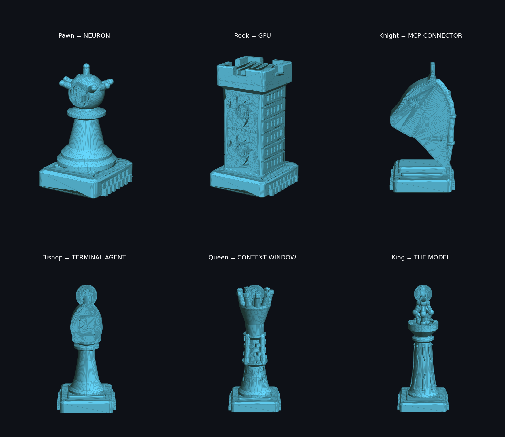
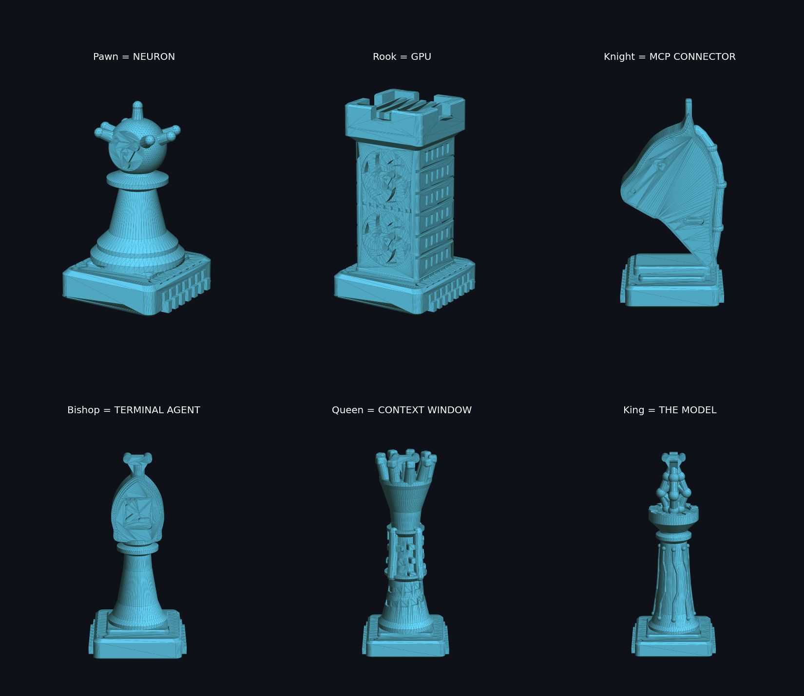
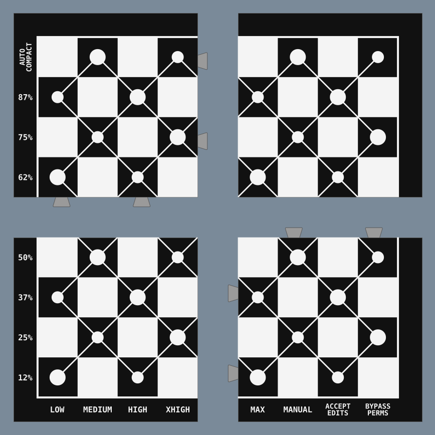

# chess-set-ai

A 3D-printable chess set themed on AI and technology. Every piece is a piece of the AI stack, and its rank on the board matches its importance in the stack. There is no text on any piece; the shape says what it is.

Every version uses the same piece designs. The only difference is the model emblem, which sits in a prominent spot on every piece. Pick two versions and print one white and one black, for example **Claude vs GPT**.

| Claude | GPT |
|---|---|
|  |  |

### Versions

| Version | Folder | Preview |
|---|---|---|
| Claude | `stl/claude/` | [image](images/preview_claude.png) |
| GPT | `stl/gpt/` | [image](images/preview_gpt.png) |
| Gemini | `stl/gemini/` | [image](images/preview_gemini.png) |
| **No logo** | `stl/plain/` | [image](images/preview_plain.png) |

The no-logo version replaces every emblem with a small network graph: a centre node and three outer nodes, all linked. It contains no trademarks, so it is the version to share on model sites.



## The pieces

| Piece | Is | Why |
|---|---|---|
| King | **The model**: a small neural network (input, hidden and output layers) on a PCB-traced body, with the emblem as the output node | Everything exists to protect it |
| Queen | **Context window**: a window sliding up a spiral ribbon of tokens. Tokens below the window are faded, tokens inside it are raised, and a cursor marks the next one | The most powerful piece: what the model can see at once |
| Bishop | **Terminal agent**: a terminal window with a `>_` prompt and window buttons | Moves far in a straight line, like an agent working through a codebase |
| Knight | **MCP connector**: a horse head with plug-prong ears, a cable along its back and socket slots in the neck | Jumps between pieces the way MCP connects tools |
| Rook | **GPU**: a tower of cooling fins and fans | The heavy compute that holds the corners |
| Pawn | **Neuron**: a cell body with dendrites | Many small units that add up |

All pieces stand on a microchip base.

## Files

```
stl/<version>/  one STL per piece + a 16-piece plate, for each version
images/         preview renders
assets/         logo SVGs, one per version (assets/<version>.svg)
src/            the generator code
store/          listing text and images for MakerWorld / Thingiverse
```

Each folder has one file per piece. You need 1 king, 1 queen, 2 bishops, 2 knights, 2 rooks and 8 pawns per side. The `plate_*_16_pieces.stl` file puts a whole side on one 4x4 plate (167 x 164 mm).

## Printing (checked for a Bambu Lab P1S)

Every STL is checked by `src/print_check.py`: it fits the 256 mm build volume, has enough bed contact, does not tip over, has no part that starts in mid-air (slice by slice, as the slicer sees it), has no thin necks that would snap, and has walls of at least 0.8 mm (two lines of a 0.4 mm nozzle).

- Scale: 100% (sized for the 28 x 28 cm board). The king is about 52 mm tall and bases are 16 to 22 mm wide. The plate fits any bed of 120 x 120 mm or more.
- Every piece is a single solid part, designed with 45° overhangs, so it prints without supports. Tree supports "touching build plate only" give a cleaner knight jaw, but are not required.
- PLA or PETG, 0.16 or 0.2 mm layers, 3 walls, 15% gyroid infill.
- Pieces are stable: they need 33° to 50° of tilt before they tip over (a normal chess piece needs about 15° to 25°).

## The board



A "neural network" board: white nodes on the dark squares, linked diagonally. The columns are the five effort levels (LOW to MAX) and three permission modes (MANUAL, ACCEPT EDITS, BYPASS PERMS). The rows show the context filling up from 12% to 87%, then AUTO COMPACT.

- Size: 28 x 28 cm (about 30.4 mm squares), 280 x 280 x 6 mm in all, made of 4 quarters of 140 x 140 mm (4 x 4 squares each) that fit the P1S.
- Joint: dovetail tabs in the lower 3.5 mm only. The top 2.5 mm meets in a straight line on a square edge, so the seam is clean, and the quarters above rest on the tabs. Clearance 0.15 mm per side.
- Print `board_TL` and `board_BR` face up, and `board_TR` and `board_BL` face down (the STLs are already oriented). None needs supports.
- Two colours (AMS): load `color/board_<q>_white.stl` and `board_<q>_black.stl` together as one object. The top 0.6 mm is split into black and white.
- Assembly: lay down TL and BR, then drop in TR and BL from above.
- Fit test first: `stl/board/test/` has one tab and sockets at 0.10, 0.15 and 0.20 mm (1, 2 or 3 notches). Rebuild with another clearance using `python src/build_board.py 0.2`.
- `boards/proposals/` has the 2D proposals that came before it (`python src/board_proposals.py`).

## Add your own version

Drop a logo SVG into `assets/` and run the build. The file name becomes the version name: `assets/mistral.svg` makes `stl/mistral/`.

The SVG reader handles paths, circles, ellipses, rects and polygons. It drops app-icon background squares, blurred glow layers and gradients, cuts white shapes out of coloured ones, and joins logos made of separate parts with thin bridges so every piece stays one part.

## Build it yourself

Requires Python 3.10 or newer.

```bash
pip install -r requirements.txt
python src/build_all.py              # every version: STLs, previews and the P1S check
python src/build_all.py gpt plain    # only some versions
python src/build_set.py gemini       # one version's STLs -> stl/gemini/
python src/print_check.py gemini     # check one version for the P1S
python src/render_preview.py gemini  # -> images/preview_gemini.png
python src/store_images.py plain     # store banner, cover and piece images -> store/images/
```

- `build_set.py`: generates every piece with [manifold3d](https://github.com/elalish/manifold) (CSG).
- `svg_emblem.py`: a small SVG reader that turns `assets/<version>.svg` into the emblem.
- `print_check.py`: printability check for the P1S.
- `render_preview.py`, `store_images.py`: renders with matplotlib.

## License

The code and the original piece designs are released under the [MIT License](LICENSE).

The logos in `assets/` (Claude, OpenAI/GPT, Gemini, Google Antigravity, Grok, DeepSeek, Qwen, Perplexity) are trademarks of their owners. They are used here as fan art for personal use only. This project is not affiliated with or endorsed by any of these companies, and the logos are not covered by the MIT license.
